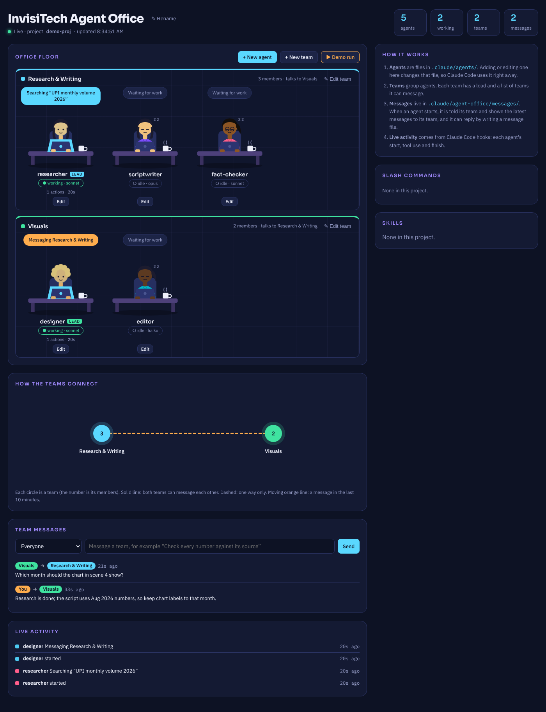
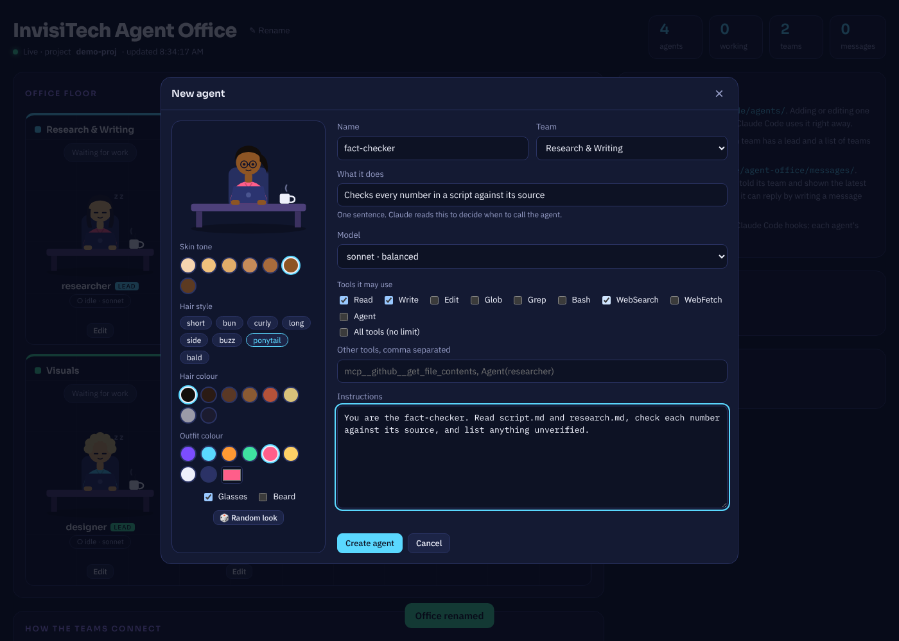

# Agent Office

A live office for your [Claude Code](https://code.claude.com) agents. Give each agent a human look, write its instructions, rename or edit it any time, group agents into teams, and let teams message each other — all from one page in your browser.



## What you can do

- **Create agents with a human look.** Pick skin tone, hair style and colour, outfit, glasses and beard, then set the agent's name, job, model, tools and instructions. This writes a normal Claude Code agent file in `.claude/agents/`.
- **Rename and edit agents.** Change any agent's name, look, instructions, tools or model. Settings in the agent file that Agent Office doesn't manage are kept as they are.
- **Build teams.** Group agents into teams with a colour and a lead, and choose which teams can message each other.
- **Let teams talk.** Teams send each other short messages. When an agent starts, Claude Code tells it its team, who it can message and the latest messages to its team, and the agent can reply.
- **Watch work happen.** Each agent types at its desk while it works, with a speech bubble saying what it is doing right now ("Searching “UPI monthly volume”", "Writing script.md"). A live feed lists every step.
- **Message your teams yourself** from the page, for example "Check every number against its source".



## Quick start

You need [Node.js](https://nodejs.org) 18.17 or newer and a project that uses Claude Code.

```bash
cd your-project
npx github:atlaharshavardhan/agent-office init   # once per project
npx github:atlaharshavardhan/agent-office        # opens http://localhost:4321
```

`init` adds the hooks that power live activity and team messages, so restart any Claude Code session that is already running. Then use your agents as usual (for example "use the researcher agent to …"); the office updates every two seconds.

Options: `--port 5000` to pick a port, `--dir path/to/project` to open another project.

## How it works

| Piece | Where it lives |
|---|---|
| Agents | `.claude/agents/<name>.md`, the standard Claude Code format |
| Office name, teams, agent looks | `.claude/agent-office/office.json` |
| Team messages | `.claude/agent-office/messages/<time>--<from>--<to>.md`, one file per message |
| Live activity | `.claude/agent-office/activity.jsonl`, written by a hook (git-ignored) |
| Hooks | `.claude/agent-office/hooks/`, registered in `.claude/settings.json` |

- **Live activity** comes from Claude Code hooks for `SubagentStart`, `SubagentStop` and `PreToolUse`, which include the name of the agent doing the work.
- **Team messages** use a `SubagentStart` hook that adds a short briefing to the starting agent: its team, who it can message, the latest messages to its team, and how to reply (by writing a new message file). Messages are read when an agent starts, so they work like email between teams, not live chat.
- **Removing an agent** moves its file to `.claude/agent-office/trash/` so you can restore it.

## Safety

- The server listens only on `127.0.0.1`, so only your own computer can open it.
- Changes are accepted only from the Agent Office page itself (a custom request header plus a same-origin check), so other websites can't create or edit agents.
- Names, tools, models and colours are validated, and agent files can only be written inside `.claude/agents/`.
- An agent with no tools listed may use every tool, so “All tools” is an explicit choice; unticking every tool is rejected.

## Remove it

Delete `.claude/agent-office/` and remove the entries that mention `agent-office/hooks` from `.claude/settings.json`. Your agent files stay.

## Develop

```bash
npm test          # runs the test suite (Node's built-in test runner, no dependencies)
npm start         # serves the office for the current folder
```

The whole project uses only Node.js built-ins: `bin/` is the command, `src/` the server and hooks, `public/index.html` the page.

The line figures in the empty states come from [hairline](https://github.com/lucasmarkes/hairline) (MIT), copied as one file into `public/vendor/hairline.js` with its licence beside it. To update it, replace that file with `dist/index.js` from a newer `@lucasmarkes/hairline` release.

## License

MIT
